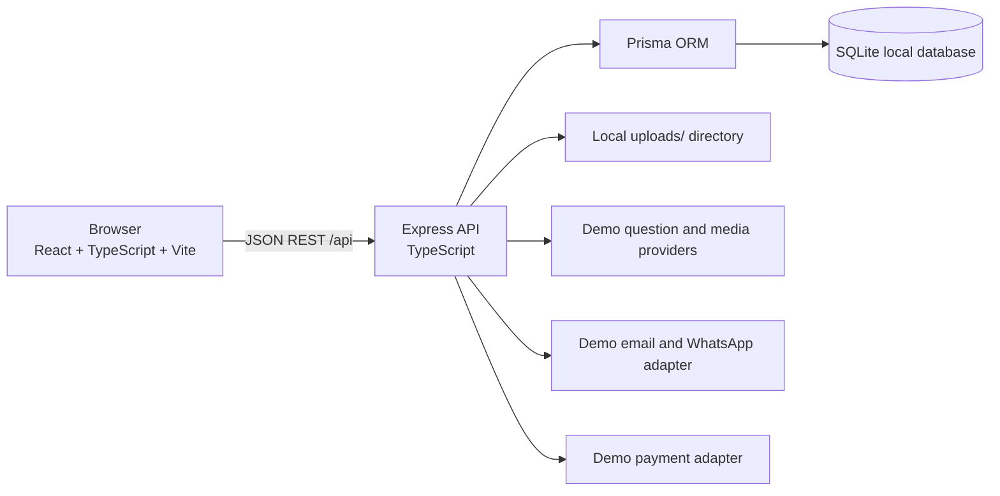

# Deployment and Physical Architecture

## Local Prototype Environment

- Node.js 20+ and npm 8 or newer; Node 22 LTS is recommended. React Router 7 declares Node 20+.
- The implementation checks were run in the available Node 16.14 / npm 8.3.1 environment. The build and tests passed there, but npm reports engine warnings; use Node 20+ for supported operation.
- A current desktop or mobile browser.
- Local disk for SQLite and uploaded media.
- No API key, cloud account, email, WhatsApp, or payment credentials are required.

## Architecture

All provider boxes are local simulations. They do not represent active integrations or external services.

## Run

1. Copy `.env.example` to `.env` and retain the local SQLite URL.
2. Run `npm install`.
3. Run `npm run db:migrate` to create/apply the Prisma migration.
4. Run `npm run db:seed` to populate demo records.
5. Run `npm run dev`; Vite serves the UI and proxies `/api` and `/uploads` to Express.

The Vite development server defaults to `http://localhost:5173`, and the API defaults to port `4000`. Set `API_PORT` in `.env` to change the API port and update the Vite proxy accordingly. Keep SQLite and uploads on local storage for this prototype.

## Operational Limitations

Role selection is not authentication. There is no production authorization, CSRF protection, cloud backup, malware scanning, external provider retry queue, or deployment hardening. Uploads are limited to 5 MB and PNG/JPEG/WEBP MIME types, but local prototype validation is not a replacement for production file inspection. Do not use real student or payment data.